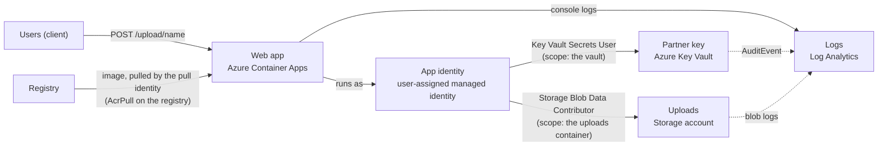

# Architecture: the secretless app

The app proves one property: it reaches Azure services with an identity and role assignments, and holds no secret. This document names the parts, shows the flow, explains the choices and says where the teaching build stops short of production.

## Components and what each owns

Names match the lesson's diagram ("The secretless app you build").

| Component (lesson name) | Azure resource | Owns | Terraform module |
|---|---|---|---|
| Users (client) | none | Sends `POST /upload/<name>` | none |
| Web app | Azure Container Apps: environment `cae-secretless`, app `ca-secretless` | The two routes, error mapping, request logging; runs as the app identity | `container_app` |
| App identity | User-assigned managed identity `id-secretless-app` | The only credential the code uses; holds exactly two roles | `user_assigned_identity` |
| Pull identity | User-assigned managed identity `id-secretless-pull` | Pulls the image (AcrPull on the registry); not used by the code | `user_assigned_identity` |
| Partner key | Azure Key Vault `kv-secretless-<suffix>` (Azure RBAC) | The secret `partner-api-key` and the audit log | `key_vault` |
| Uploads | Storage account `stsecretless<suffix>`, container `uploads`, shared key access disabled | The blobs and the blob service logs | `storage_uploads` |
| Logs | Log Analytics workspace `law-secretless` | Console logs, `AuditEvent`, `StorageRead/Write/Delete` | `log_analytics` |
| Registry | Azure Container Registry (Basic) | The image | `container_registry` |
| Role assignments | Azure RBAC | Who may do what, at what scope; refuses wide scopes | `role_assignments` |
| Budget | Subscription budget | Alert at 80 and 100 percent | `budget` |

Inside the application (`src/secretless_app/`):

| Layer | Holds | May import |
|---|---|---|
| `domain` | `BlobName` (naming rule), `Secret` (never prints), `HealthReport`, named errors | the standard library |
| `application` | `CheckHealth`, `SaveUpload`, the `SecretStore` and `BlobStore` ports, `Services` | domain |
| `infrastructure` | Key Vault and Blob adapters, error translation, in-memory adapters, settings, JSON logging, composition root | domain, application, SDKs |
| `interfaces` | Flask routes, error handlers, request log, gunicorn entry point | everything above; nothing imports it |

## Pattern: ports and adapters

The system has two outbound boundaries (the vault and the storage account) and one inbound (HTTP). A port per outbound boundary keeps the use cases free of the SDK, so the unit tests use in-memory fakes and the e2e test runs the real server with `BACKEND=memory`. The same ports are why the app is identical on a laptop and in Azure: only `DefaultAzureCredential` changes behavior (see decision 2). `import-linter` enforces the direction of imports in `make lint`.

## Data flow

### One upload, step by step

1. The client sends `POST /upload/hello.txt` with the file as the body.
2. Container Apps ingress terminates TLS and forwards to a replica (scaling from zero if needed).
3. Flask rejects a body above `MAX_UPLOAD_BYTES` (413) before reading it, then calls `SaveUpload`.
4. `SaveUpload` builds a `BlobName` (400 on a bad name) and checks the size again; the rule lives in the application, not only in the web framework.
5. `BlobUploads.put` calls the SDK with `DefaultAzureCredential`. In Azure the credential asks the instance metadata service for a token for the identity named by `AZURE_CLIENT_ID`; the token is short-lived and cached by the SDK, so nothing is stored or rotated by hand.
6. Storage checks the token's role assignments at the container scope. With `Storage Blob Data Contributor` it writes the blob and answers 201. Without it, it answers 403 `AuthorizationPermissionMismatch`.
7. A 403 is translated to `AccessDeniedError` and mapped to HTTP 502 `upstream_access_denied`. The client sees the service and the code; the log line carries the SDK's full message, which names the caller's object id and the denied action.
8. The request log line (method, path, status, duration) is written as one JSON object on stdout; Container Apps ships it to Log Analytics.

`GET /health` follows the same path through the vault with `Key Vault Secrets User`, and reports only the length of the key.

## Decisions and trade-offs

1. **Two user-assigned identities, not one and not system-assigned.** The lesson wants the app's identity to hold exactly two roles. Pulling the image needs a third (AcrPull), so a separate pull identity carries it. A user-assigned identity is its own resource: it survives replacing the app and can be attached to several apps, and its role assignments can be created before the app exists (no ordering trap). A system-assigned identity is simpler for one app but is deleted with it, and its principal does not exist until the app does, so the roles could only be assigned afterwards.
2. **`DefaultAzureCredential` with an optional `AZURE_CLIENT_ID`.** In Azure it finds the managed identity; on a laptop it falls back to `az login`. The cost is that a misconfigured app can fall through the chain to a source nobody intended (an environment variable credential, a developer login); here none of those is set in Azure, and the audit step searches for them. `AZURE_CLIENT_ID` is required when more than one identity is attached (here, two), because the platform cannot guess which one the code means.
3. **Azure RBAC on the vault, not access policies.** One permission model across Azure, with scopes, deny assignments and the same audit trail. The price is propagation delay (minutes), which the lesson measures on purpose.
4. **The secret never enters Terraform state.** `scripts/seed-secret.sh` sets it with the CLI. A `azurerm_key_vault_secret` would write the value to `terraform.tfstate`, which is a second place a secret lives.
5. **The container is created through the Resource Manager API.** `azurerm_storage_container` with `storage_account_id` needs no key and no data role, which is the only way Terraform can create it when shared key access is off.
6. **Two-phase apply with a registry.** The container app needs an image that exists; the image needs a registry. Phase 1 (`deploy_app = false`) builds everything except the app; `make deploy` builds the image and applies again with `deploy_app = true`. The alternative, a placeholder public image, would run a different program with different ports for a while.
7. **A denial is a 502, not a 403.** The caller of the app is not forbidden; the app's identity was refused by a dependency. A 403 would tell the client to change something it cannot. The body has the service and the code (no object ids); the log has everything.
8. **Liveness does not touch dependencies.** `/live` answers from the process. If liveness depended on the vault, removing a role (step 5) would restart the app in a loop and hide the very denial being studied.
9. **Tests with `terraform test` and a mocked provider.** A real `plan` of `azurerm` needs a signed-in session even for create-only changes (the provider authenticates when it configures). The mocked-provider tests give a credential-free plan and apply that assert the composition: who holds which role at which scope, and which settings the app receives. They do not prove Azure accepts the resources; `terraform apply` does that.
10. **Checkov skips live next to the resource.** Each of the 19 skips has the reason on the line that suppresses it, so a reviewer reads the trade-off where the code is.

## Failure modes the lesson teaches, and how this code shows them

| Failure | Signal | How to see it here |
|---|---|---|
| Blob role missing or removed | `POST /upload` answers 502 `upstream_access_denied`, `code` `AuthorizationPermissionMismatch`; Storage log shows `StatusCode 403` and `RequesterObjectId` equal to the identity's principal id | Offline: `make run-denied`. Azure: `scripts/break-and-measure.sh blob`, `scripts/read-denials.sh blob` |
| Vault role missing or removed | `GET /health` answers 502, `code` `ForbiddenByRbac`; `AuditEvent` shows 403 with the caller's `oid` | Offline: `MEMORY_DENY=vault make run`. Azure: `scripts/break-and-measure.sh vault` |
| Role change not yet effective | The 403 does not appear for minutes after removal, and success does not return for minutes after restore | `break-and-measure.sh` prints both durations |
| Account key used | `KeyBasedAuthenticationNotPermitted` | `scripts/prove-key-access-closed.sh` |
| Role assigned at the wrong scope | It works, and the identity can read every container | `role_assignments` refuses resource group and subscription scopes at plan time |
| Client id used as principal id | `principal does not exist` | Outputs name both: `app_identity_client_id` and `app_identity_principal_id` |
| Owner without a data role | Creating the secret is refused | The deployer gets `Key Vault Secrets Officer`; `seed-secret.sh` retries while the role propagates |
| Re-creating a deleted vault with the same name | The create fails: the name is reserved by soft delete | `make down` lists the soft-deleted vault with its purge date; names carry a random suffix so a second run does not collide |

## Limits of the teaching build against production

- Public endpoints on the vault, storage account and registry. Production would use private endpoints and `public_network_access_enabled = false` (the next project builds this).
- Local Terraform state. Production would use a remote backend with locking and a pipeline that runs `plan` on pull requests.
- No autoscaling rules beyond the platform's HTTP concurrency, no custom domain or WAF in front, no alerting.
- No secret rotation: the app reads the secret on each `/health` call, so a rotated value is picked up; a real consumer of the partner key would cache it with a time to live.
- The container image is scanned only by what Basic offers (nothing). Production would sign and scan images (Premium registry and Defender for Containers).
- Purge protection is off by default (variable), so practice vaults can be purged.

## How to extend it

- **System-assigned identity:** add an `identity { type = "SystemAssigned" }` variant in `container_app`, assign roles after the app exists (depends on the app), and compare the life cycle with `az identity` resources surviving a `terraform destroy -target`.
- **Private endpoint:** set `public_network_access_enabled = false` on the vault, add a private endpoint, a private DNS zone and a virtual-network-integrated environment; see `azure-private-platform-slice`.
- **Alert on repeated denials:** a scheduled query rule over the `StorageBlobLogs` and `AzureDiagnostics` queries in `scripts/read-denials.sh`, firing at more than N denials in 5 minutes.
- **A second app:** attach `id-secretless-app` to another container app and see that the roles follow the identity, not the app.
